# Dataset EDA: first-N packet research

## Scope and interpretation

13,314 unique flows; 8,286 feature representations at N=3,5,10,20.
Feature rows are repeated representations, not independent flows. Labels are
capture-derived and unverified. UNRESOLVED is retained separately and is not an
eighth official activity class. This report describes eligibility, not accuracy.

## Provisional imbalance

Among assigned candidates, VOIP is largest (7,870) and CHAT smallest (544); ratio 14.47:1.
These are full-dataset descriptive counts, not final training-set majority/minority
definitions. Missing classes cannot be treated as minority classes with observations.

| candidate_class | unique_flows | distinct_captures | dataset_pct | resolved_candidate_pct |
| --- | --- | --- | --- | --- |
| BROWSING | 0 | 0 | 0.000 | 0.000 |
| CHAT | 544 | 15 | 4.086 | 5.154 |
| STREAMING | 0 | 0 | 0.000 | 0.000 |
| MAIL | 818 | 4 | 6.144 | 7.751 |
| VOIP | 7870 | 12 | 59.111 | 74.569 |
| P2P | 0 | 0 | 0.000 | 0.000 |
| FT | 1322 | 4 | 9.929 | 12.526 |
| UNRESOLVED | 2760 | 14 | 20.730 | N/A |

## Eligibility and changing cohorts

| candidate_class | n_packets | total_flows | eligible_flows | coverage_pct | eligible_cohort_pct |
| --- | --- | --- | --- | --- | --- |
| BROWSING | 3 | 0 | 0 | N/A | 0.000 |
| BROWSING | 5 | 0 | 0 | N/A | 0.000 |
| BROWSING | 10 | 0 | 0 | N/A | 0.000 |
| BROWSING | 20 | 0 | 0 | N/A | 0.000 |
| CHAT | 3 | 544 | 387 | 71.140 | 12.098 |
| CHAT | 5 | 544 | 246 | 45.221 | 11.136 |
| CHAT | 10 | 544 | 156 | 28.676 | 8.809 |
| CHAT | 20 | 544 | 92 | 16.912 | 8.311 |
| STREAMING | 3 | 0 | 0 | N/A | 0.000 |
| STREAMING | 5 | 0 | 0 | N/A | 0.000 |
| STREAMING | 10 | 0 | 0 | N/A | 0.000 |
| STREAMING | 20 | 0 | 0 | N/A | 0.000 |
| MAIL | 3 | 818 | 439 | 53.667 | 13.723 |
| MAIL | 5 | 818 | 349 | 42.665 | 15.799 |
| MAIL | 10 | 818 | 283 | 34.597 | 15.980 |
| MAIL | 20 | 818 | 247 | 30.196 | 22.313 |
| VOIP | 3 | 7870 | 986 | 12.529 | 30.822 |
| VOIP | 5 | 7870 | 710 | 9.022 | 32.141 |
| VOIP | 10 | 7870 | 576 | 7.319 | 32.524 |
| VOIP | 20 | 7870 | 389 | 4.943 | 35.140 |
| P2P | 3 | 0 | 0 | N/A | 0.000 |
| P2P | 5 | 0 | 0 | N/A | 0.000 |
| P2P | 10 | 0 | 0 | N/A | 0.000 |
| P2P | 20 | 0 | 0 | N/A | 0.000 |
| FT | 3 | 1322 | 324 | 24.508 | 10.128 |
| FT | 5 | 1322 | 227 | 17.171 | 10.276 |
| FT | 10 | 1322 | 197 | 14.902 | 11.124 |
| FT | 20 | 1322 | 123 | 9.304 | 11.111 |
| UNRESOLVED | 3 | 2760 | 1063 | 38.514 | 33.229 |
| UNRESOLVED | 5 | 2760 | 677 | 24.529 | 30.647 |
| UNRESOLVED | 10 | 2760 | 559 | 20.254 | 31.564 |
| UNRESOLVED | 20 | 2760 | 256 | 9.275 | 23.126 |

The N=20 cohort contains 1,107 flows (8.315% of all flows).
All have all four representations. Comparing each N's full eligible population
changes both class composition and flow identity. Primary classifier comparisons
must instead use a fixed common cohort and fixed group-safe partitions.

Loss between N=3 and N=20 (relative to the N=3 eligible population):

| candidate_class | n3_flows | n20_flows | lost_n3_to_n20 | loss_pct_of_n3 |
| --- | --- | --- | --- | --- |
| BROWSING | 0 | 0 | 0 | N/A |
| CHAT | 387 | 92 | 295 | 76.227 |
| FT | 324 | 123 | 201 | 62.037 |
| MAIL | 439 | 247 | 192 | 43.736 |
| P2P | 0 | 0 | 0 | N/A |
| STREAMING | 0 | 0 | 0 | N/A |
| UNRESOLVED | 1063 | 256 | 807 | 75.917 |
| VOIP | 986 | 389 | 597 | 60.548 |

Among populated categories, the greatest proportional N=3-to-N=20 attrition is
CHAT
(76.23%).
Class shares within the final eligible cohort are:

| candidate_class | eligible_flows | eligible_cohort_pct |
| --- | --- | --- |
| BROWSING | 0 | 0.000 |
| CHAT | 92 | 8.311 |
| STREAMING | 0 | 0.000 |
| MAIL | 247 | 22.313 |
| VOIP | 389 | 35.140 |
| P2P | 0 | 0.000 |
| FT | 123 | 11.111 |
| UNRESOLVED | 256 | 23.126 |

These composition shifts can change which candidates appear descriptively dominant.
They must be distinguished from differences in classifier learning difficulty.

## Short flows, protocols, and capture concentration

10,115 flows contain fewer than three packets; 10,004
of these are UDP. There are 9,646 two-packet flows.
N=20 has 987 TCP and 120 UDP flows.
This association supports short UDP conversations as a contributor to low coverage;
it does not establish application identity, packet-loss causes, or parser correctness.

The largest capture, `NonVPN-PCAPs-02/hangouts_audio4.pcapng`, contributes 4,352 flows
(32.69% of the dataset). Capture concentration reduces effective
diversity; separate capture files are not proven independent recording sessions.

| capture_id | candidate_class | archive | unique_flows | short_flows | n20_flows | dataset_pct |
| --- | --- | --- | --- | --- | --- | --- |
| NonVPN-PCAPs-02/hangouts_audio4.pcapng | VOIP | NonVPN-PCAPs-02 | 4352 | 4257 | 81 | 32.687 |
| NonVPN-PCAPs-02/hangouts_video2a.pcap | UNRESOLVED | NonVPN-PCAPs-02 | 1376 | 1308 | 59 | 10.335 |
| NonVPN-PCAPs-02/ftps_down_1a.pcap | FT | NonVPN-PCAPs-02 | 1091 | 926 | 44 | 8.194 |
| NonVPN-PCAPs-02/hangouts_audio1a.pcap | VOIP | NonVPN-PCAPs-02 | 884 | 845 | 29 | 6.640 |
| NonVPN-PCAPs-02/hangouts_audio2a.pcap | VOIP | NonVPN-PCAPs-02 | 863 | 819 | 39 | 6.482 |
| NonVPN-PCAPs-01/facebook_audio4.pcapng | VOIP | NonVPN-PCAPs-01 | 632 | 461 | 31 | 4.747 |
| NonVPN-PCAPs-01/email2a.pcap | MAIL | NonVPN-PCAPs-01 | 361 | 197 | 83 | 2.711 |
| NonVPN-PCAPs-01/email2b.pcap | MAIL | NonVPN-PCAPs-01 | 318 | 123 | 94 | 2.388 |
| NonVPN-PCAPs-01/facebook_audio3.pcapng | VOIP | NonVPN-PCAPs-01 | 264 | 72 | 59 | 1.983 |
| NonVPN-PCAPs-01/facebook_audio2a.pcap | VOIP | NonVPN-PCAPs-01 | 261 | 179 | 16 | 1.960 |

| protocol | n_packets | total_flows | eligible_flows | coverage_pct |
| --- | --- | --- | --- | --- |
| TCP | 3 | 2419 | 2308 | 95.411 |
| TCP | 5 | 2419 | 1915 | 79.165 |
| TCP | 10 | 2419 | 1613 | 66.680 |
| TCP | 20 | 2419 | 987 | 40.802 |
| UDP | 3 | 10895 | 891 | 8.178 |
| UDP | 5 | 10895 | 294 | 2.698 |
| UDP | 10 | 10895 | 158 | 1.450 |
| UDP | 20 | 10895 | 120 | 1.101 |

| protocol | unique_flows | dataset_pct |
| --- | --- | --- |
| TCP | 2419 | 18.169 |
| UDP | 10895 | 81.831 |

## Observation delay

All delay statistics use milliseconds. Quantiles use pandas' linear interpolation.
Exact zeros are retained. ECDF/median figures use symlog axes to expose skew and
retain zeros. Aggregate-prefix observation delay is not inference or processing latency.

N-specific eligible cohorts:

| n_packets | count | median_ms | mean_ms | p90_ms | p95_ms | zero_count |
| --- | --- | --- | --- | --- | --- | --- |
| 3 | 3199 | 47.184 | 5,002.410 | 24,780.572 | 45,055.961 | 0 |
| 5 | 2209 | 77.700 | 11,998.855 | 59,999.248 | 90,112.004 | 0 |
| 10 | 1771 | 194.685 | 23,479.937 | 120,167.086 | 180,249.102 | 0 |
| 20 | 1107 | 462.936 | 25,344.913 | 76,241.772 | 177,071.948 | 0 |

Fixed common N=20 cohort (same identities at every N):

| n_packets | count | median_ms | mean_ms | p90_ms | p95_ms | zero_count |
| --- | --- | --- | --- | --- | --- | --- |
| 3 | 1107 | 27.705 | 2,420.179 | 2,461.554 | 28,243.818 | 0 |
| 5 | 1107 | 52.982 | 4,868.983 | 5,893.946 | 49,918.480 | 0 |
| 10 | 1107 | 123.447 | 9,979.497 | 30,002.354 | 68,315.533 | 0 |
| 20 | 1107 | 462.936 | 25,344.913 | 76,241.772 | 177,071.948 | 0 |

Class-specific distributions and sample counts are in `tables/delay_by_class_n.csv`.
Changes across N-specific cohorts must not be attributed solely to packet budget.

## Archives

| archive | unique_flows | captures | median_packets | p95_packets | short_flows | n3_flows | n3_coverage_pct | n5_flows | n5_coverage_pct | n10_flows | n10_coverage_pct | n20_flows | n20_coverage_pct |
| --- | --- | --- | --- | --- | --- | --- | --- | --- | --- | --- | --- | --- | --- |
| NonVPN-PCAPs-01 | 2995 | 23 | 2.000 | 53.300 | 1508 | 1487 | 49.649 | 983 | 32.821 | 768 | 25.643 | 509 | 16.995 |
| NonVPN-PCAPs-02 | 10319 | 26 | 2.000 | 26.000 | 8607 | 1712 | 16.591 | 1226 | 11.881 | 1003 | 9.720 | 598 | 5.795 |

Archive 02 raw PCAPs are not yet locally available for verification according to
the project context. Explicit archive-02 raw paths detected: False.
Flat filenames do not independently establish archive provenance; no raw packets
were parsed here. Archive 02 statistics are descriptions of existing processed data.
Packet-count bins and prefix mean packet sizes are reported separately: a packet
size aggregate is not a per-packet size distribution or a full-flow mean size.

## Preliminary experiment support and limitations

| candidate_class | eligible_flows | coverage_pct |
| --- | --- | --- |
| BROWSING | 0 | N/A |
| CHAT | 92 | 16.912 |
| STREAMING | 0 | N/A |
| MAIL | 247 | 30.196 |
| VOIP | 389 | 4.943 |
| P2P | 0 | N/A |
| FT | 123 | 9.304 |
| UNRESOLVED | 256 | 9.275 |

Counts support implementation of preliminary weak-label baselines for represented
candidates. They do not establish adequate independent test support. CHAT has
92 N=20 candidates. Candidates with no flows: BROWSING, STREAMING, P2P.
49 captures have unknown recording groups in the labeled dataset.
Resolve label provenance, background traffic, and independent recording groups
before claiming class-specific generalization. Validate archive 02 short flows and
historical preprocessing provenance. Neither low coverage nor minority status
implies poor accuracy or a need for more packets; classifiers have not been evaluated.

## Figures and tables


### Class Distribution

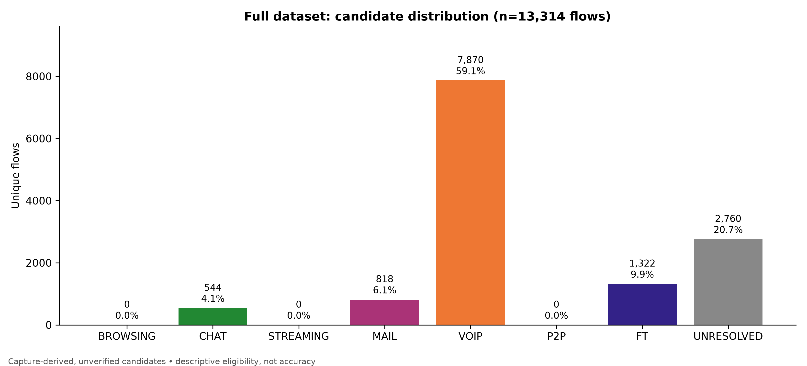

### Class By N

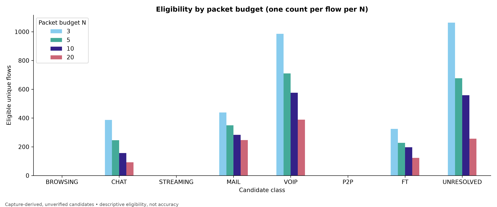

### Packet Budget Coverage

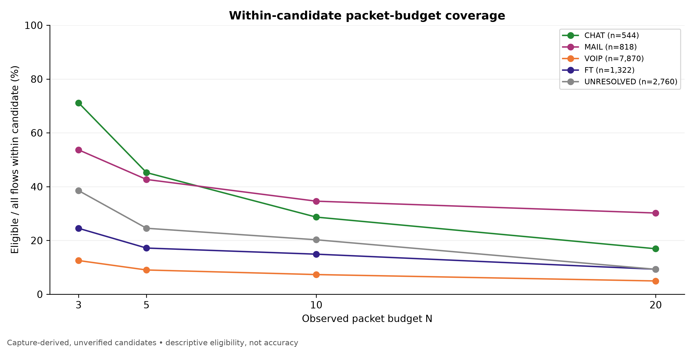

### Flow Length Distribution

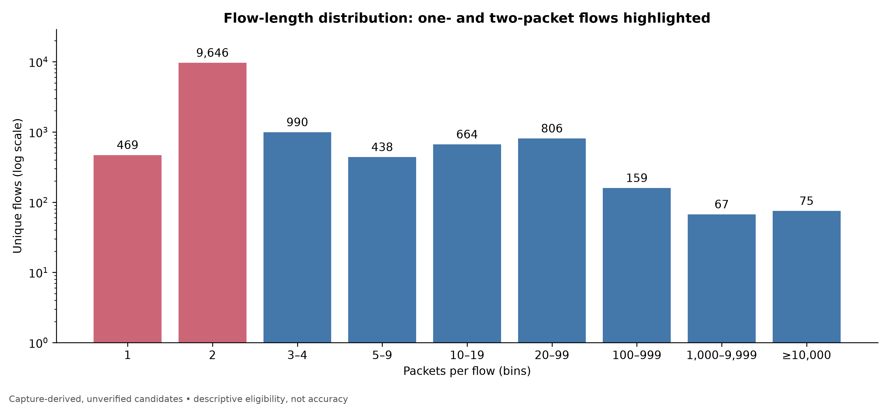

### Flow Length By Class

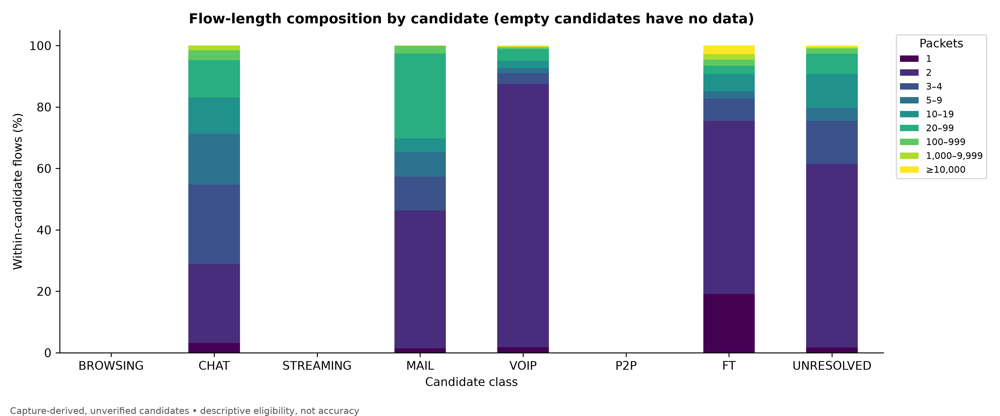

### Protocol By Class

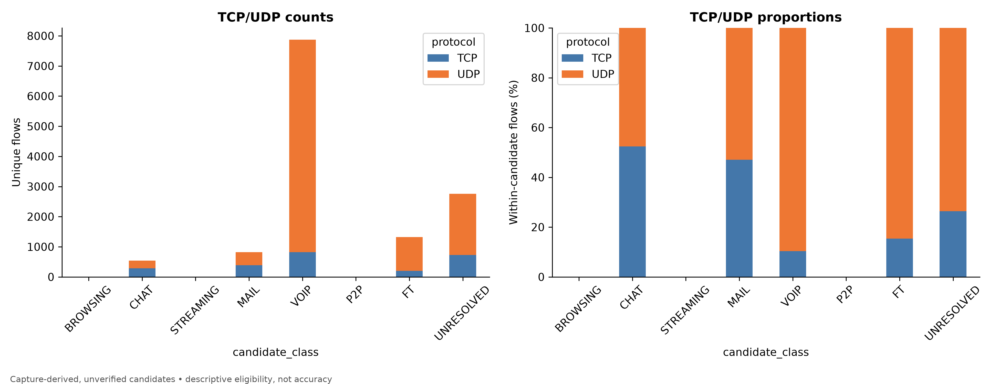

### Capture Distribution

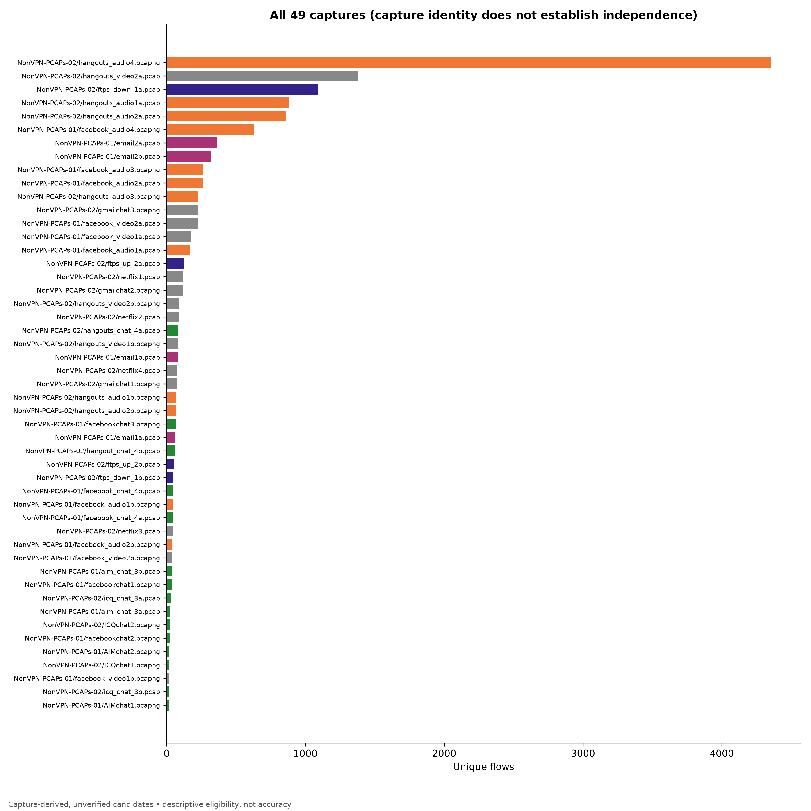

### Captures Per Class

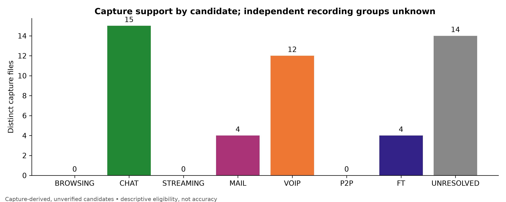

### Observation Delay Ecdf

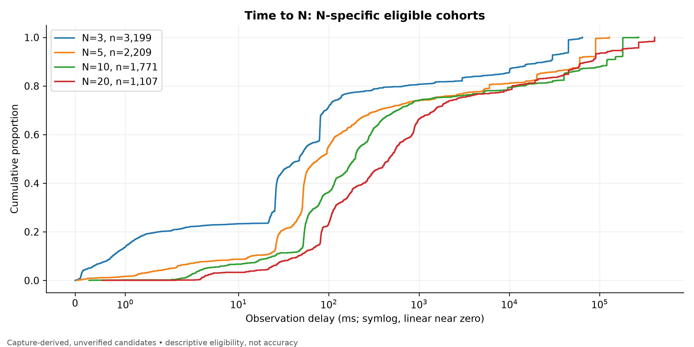

### Observation Delay By Class

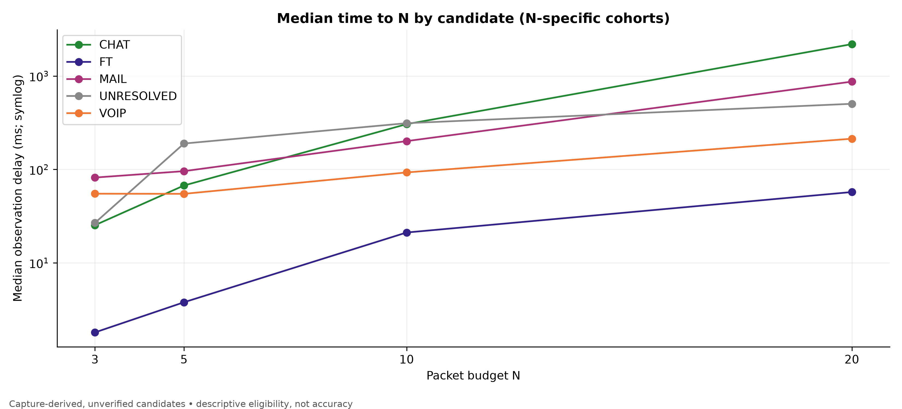

### Archive Comparison

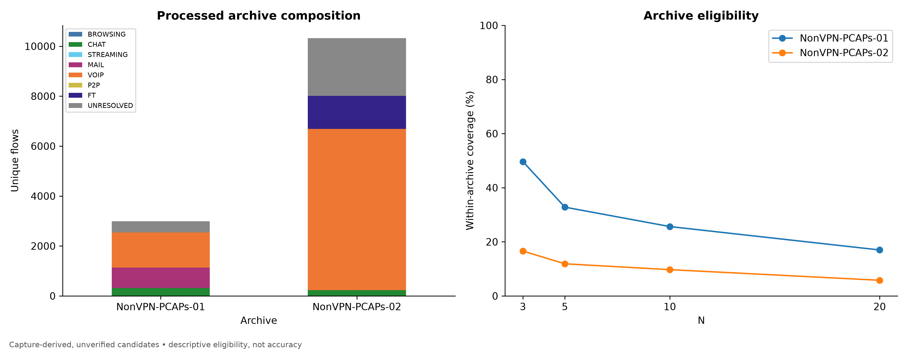

### Archive Length Comparison

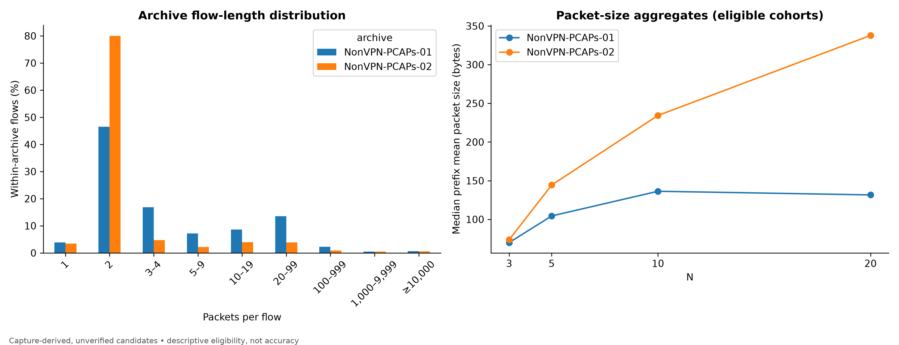

## Reproduction

```powershell
python -m src.analysis.dataset_eda
python -m unittest discover -s tests -p test_dataset_eda.py -v
```

All statistical tables are under `tables/`; `validation.json` records input hashes, versions, and validation. Source datasets and labeling outputs are never overwritten.
