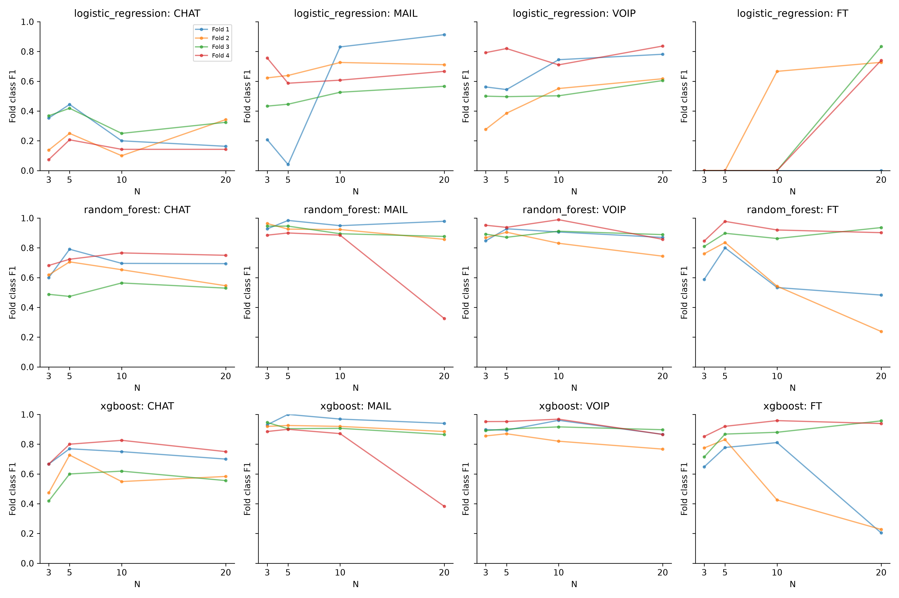
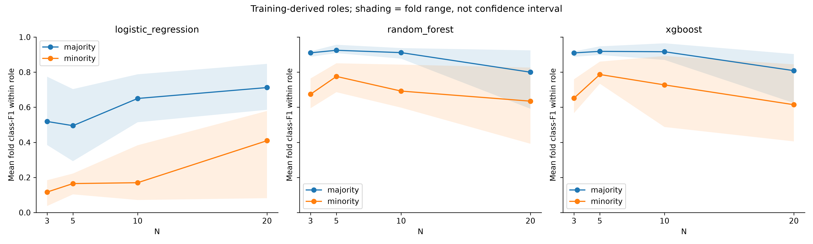
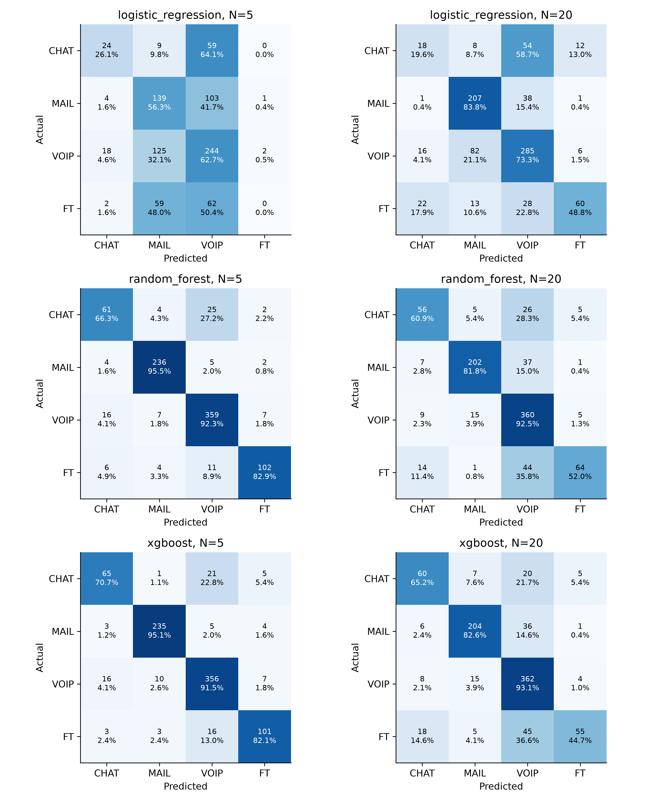
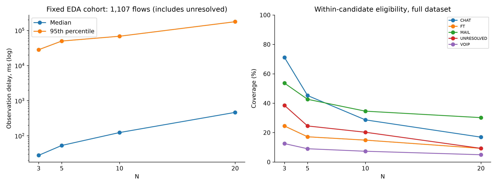
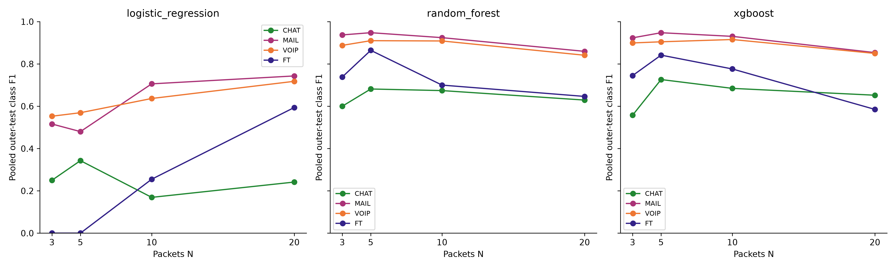

# Completed experiment analysis

## Scope and estimands

Three completed models, four packet budgets, four capture-disjoint outer folds.
Every model/N pools one held-out prediction for each of the same 851 flows: CHAT 92,
MAIL 247, VOIP 389, FT 123. Inputs and saved result checksums were validated; class
metrics and confusion counts were recomputed from predictions without fitting.
Targets are unverified capture-derived candidates. No model, dataset, split, or
existing result is modified by this analysis.

Pooled metrics concatenate all outer-test predictions before computing precision,
recall and F1. Fold means average four separately calculated metrics without weighting
by fold size. They are different estimands: F1 is nonlinear and test supports differ.
Fold SD/range are descriptive variability, not standard errors or confidence intervals;
folds share training data. No statistical significance or optimality is claimed.

## Overall pooled results and observed budgets

| model | n_packets | accuracy | macro_f1 | weighted_f1 | support |
| --- | --- | --- | --- | --- | --- |
| logistic_regression | 3 | 0.477 | 0.330 | 0.430 | 851 |
| logistic_regression | 5 | 0.478 | 0.348 | 0.437 | 851 |
| logistic_regression | 10 | 0.591 | 0.442 | 0.551 | 851 |
| logistic_regression | 20 | 0.670 | 0.574 | 0.656 | 851 |
| random_forest | 3 | 0.851 | 0.791 | 0.849 | 851 |
| random_forest | 5 | 0.891 | 0.851 | 0.890 | 851 |
| random_forest | 10 | 0.861 | 0.802 | 0.858 | 851 |
| random_forest | 20 | 0.801 | 0.744 | 0.795 | 851 |
| xgboost | 3 | 0.851 | 0.781 | 0.847 | 851 |
| xgboost | 5 | 0.890 | 0.855 | 0.889 | 851 |
| xgboost | 10 | 0.877 | 0.827 | 0.875 | 851 |
| xgboost | 20 | 0.800 | 0.735 | 0.791 | 851 |

| model | best_observed_n | macro_f1 |
| --- | --- | --- |
| logistic_regression | 20 | 0.574 |
| random_forest | 5 | 0.851 |
| xgboost | 5 | 0.855 |

These are retrospective maxima on saved test results, not validation-based choices
or authorization to tune using test outcomes. The primary comparison remains all N.

## Per-class precision, recall, F1 and support — pooled outer tests

| model | n_packets | candidate_class | precision | recall | f1 | support |
| --- | --- | --- | --- | --- | --- | --- |
| logistic_regression | 3 | CHAT | 0.444 | 0.174 | 0.250 | 92 |
| logistic_regression | 3 | FT | 0.000 | 0.000 | 0.000 | 123 |
| logistic_regression | 3 | MAIL | 0.444 | 0.615 | 0.516 | 247 |
| logistic_regression | 3 | VOIP | 0.504 | 0.612 | 0.553 | 389 |
| logistic_regression | 5 | CHAT | 0.500 | 0.261 | 0.343 | 92 |
| logistic_regression | 5 | FT | 0.000 | 0.000 | 0.000 | 123 |
| logistic_regression | 5 | MAIL | 0.419 | 0.563 | 0.480 | 247 |
| logistic_regression | 5 | VOIP | 0.521 | 0.627 | 0.569 | 389 |
| logistic_regression | 10 | CHAT | 0.289 | 0.120 | 0.169 | 92 |
| logistic_regression | 10 | FT | 0.731 | 0.154 | 0.255 | 123 |
| logistic_regression | 10 | MAIL | 0.616 | 0.826 | 0.706 | 247 |
| logistic_regression | 10 | VOIP | 0.590 | 0.692 | 0.637 | 389 |
| logistic_regression | 20 | CHAT | 0.316 | 0.196 | 0.242 | 92 |
| logistic_regression | 20 | FT | 0.759 | 0.488 | 0.594 | 123 |
| logistic_regression | 20 | MAIL | 0.668 | 0.838 | 0.743 | 247 |
| logistic_regression | 20 | VOIP | 0.704 | 0.733 | 0.718 | 389 |
| random_forest | 3 | CHAT | 0.614 | 0.587 | 0.600 | 92 |
| random_forest | 3 | FT | 0.782 | 0.699 | 0.738 | 123 |
| random_forest | 3 | MAIL | 0.970 | 0.907 | 0.937 | 247 |
| random_forest | 3 | VOIP | 0.853 | 0.925 | 0.888 | 389 |
| random_forest | 5 | CHAT | 0.701 | 0.663 | 0.682 | 92 |
| random_forest | 5 | FT | 0.903 | 0.829 | 0.864 | 123 |
| random_forest | 5 | MAIL | 0.940 | 0.955 | 0.948 | 247 |
| random_forest | 5 | VOIP | 0.897 | 0.923 | 0.910 | 389 |
| random_forest | 10 | CHAT | 0.685 | 0.663 | 0.674 | 92 |
| random_forest | 10 | FT | 0.794 | 0.626 | 0.700 | 123 |
| random_forest | 10 | MAIL | 0.910 | 0.939 | 0.924 | 247 |
| random_forest | 10 | VOIP | 0.885 | 0.933 | 0.909 | 389 |
| random_forest | 20 | CHAT | 0.651 | 0.609 | 0.629 | 92 |
| random_forest | 20 | FT | 0.853 | 0.520 | 0.646 | 123 |
| random_forest | 20 | MAIL | 0.906 | 0.818 | 0.860 | 247 |
| random_forest | 20 | VOIP | 0.771 | 0.925 | 0.841 | 389 |
| xgboost | 3 | CHAT | 0.630 | 0.500 | 0.558 | 92 |
| xgboost | 3 | FT | 0.742 | 0.748 | 0.745 | 123 |
| xgboost | 3 | MAIL | 0.920 | 0.927 | 0.923 | 247 |
| xgboost | 3 | VOIP | 0.881 | 0.918 | 0.899 | 389 |
| xgboost | 5 | CHAT | 0.747 | 0.707 | 0.726 | 92 |
| xgboost | 5 | FT | 0.863 | 0.821 | 0.842 | 123 |
| xgboost | 5 | MAIL | 0.944 | 0.951 | 0.948 | 247 |
| xgboost | 5 | VOIP | 0.894 | 0.915 | 0.905 | 389 |
| xgboost | 10 | CHAT | 0.674 | 0.696 | 0.684 | 92 |
| xgboost | 10 | FT | 0.885 | 0.691 | 0.776 | 123 |
| xgboost | 10 | MAIL | 0.914 | 0.947 | 0.930 | 247 |
| xgboost | 10 | VOIP | 0.899 | 0.933 | 0.916 | 389 |
| xgboost | 20 | CHAT | 0.652 | 0.652 | 0.652 | 92 |
| xgboost | 20 | FT | 0.846 | 0.447 | 0.585 | 123 |
| xgboost | 20 | MAIL | 0.883 | 0.826 | 0.854 | 247 |
| xgboost | 20 | VOIP | 0.782 | 0.931 | 0.850 | 389 |

## Class-specific changes and best observed N

| model | candidate_class | f1_n3 | f1_n5 | f1_n10 | f1_n20 | delta_3_to_20 | delta_5_to_10 | delta_5_to_20 | best_observed_n | best_observed_f1 |
| --- | --- | --- | --- | --- | --- | --- | --- | --- | --- | --- |
| logistic_regression | CHAT | 0.250 | 0.343 | 0.169 | 0.242 | -0.008 | -0.174 | -0.101 | 5 | 0.343 |
| logistic_regression | FT | 0.000 | 0.000 | 0.255 | 0.594 | 0.594 | 0.255 | 0.594 | 20 | 0.594 |
| logistic_regression | MAIL | 0.516 | 0.480 | 0.706 | 0.743 | 0.227 | 0.226 | 0.263 | 20 | 0.743 |
| logistic_regression | VOIP | 0.553 | 0.569 | 0.637 | 0.718 | 0.165 | 0.067 | 0.148 | 20 | 0.718 |
| random_forest | CHAT | 0.600 | 0.682 | 0.674 | 0.629 | 0.029 | -0.008 | -0.052 | 5 | 0.682 |
| random_forest | FT | 0.738 | 0.864 | 0.700 | 0.646 | -0.092 | -0.164 | -0.218 | 5 | 0.864 |
| random_forest | MAIL | 0.937 | 0.948 | 0.924 | 0.860 | -0.078 | -0.023 | -0.088 | 5 | 0.948 |
| random_forest | VOIP | 0.888 | 0.910 | 0.909 | 0.841 | -0.047 | -0.001 | -0.069 | 5 | 0.910 |
| xgboost | CHAT | 0.558 | 0.726 | 0.684 | 0.652 | 0.095 | -0.042 | -0.074 | 5 | 0.726 |
| xgboost | FT | 0.745 | 0.842 | 0.776 | 0.585 | -0.160 | -0.065 | -0.257 | 5 | 0.842 |
| xgboost | MAIL | 0.923 | 0.948 | 0.930 | 0.854 | -0.070 | -0.017 | -0.094 | 5 | 0.948 |
| xgboost | VOIP | 0.899 | 0.905 | 0.916 | 0.850 | -0.049 | 0.011 | -0.055 | 10 | 0.916 |

Logistic Regression's FT, MAIL and VOIP improve from N=3 to N=20; CHAT remains weak
and is nonmonotonic, with its maximum at N=5. Random Forest peaks at N=5 for all
four classes and declines thereafter. XGBoost peaks at N=5 for CHAT/MAIL/FT, while
VOIP's maximum is N=10. Thus increased observation does not uniformly improve these
aggregate-feature models. This is not evidence that minority classes universally
need more packets: FT improves strongly for Logistic Regression but deteriorates
after N=5 for both tree ensembles.

## Fold variability and capture concentration

N=20 snapshot (full N-by-class table in tables/fold_variability.csv):

| model | candidate_class | n_packets | fold_mean_f1 | fold_std_f1 | fold_min_f1 | fold_max_f1 | test_support_min | test_support_max |
| --- | --- | --- | --- | --- | --- | --- | --- | --- |
| logistic_regression | CHAT | 20 | 0.243 | 0.105 | 0.143 | 0.343 | 22 | 24 |
| logistic_regression | FT | 20 | 0.575 | 0.386 | 0.000 | 0.833 | 23 | 44 |
| logistic_regression | MAIL | 20 | 0.714 | 0.146 | 0.566 | 0.913 | 32 | 94 |
| logistic_regression | VOIP | 20 | 0.710 | 0.117 | 0.605 | 0.837 | 93 | 101 |
| random_forest | CHAT | 20 | 0.630 | 0.109 | 0.529 | 0.750 | 22 | 24 |
| random_forest | FT | 20 | 0.640 | 0.338 | 0.238 | 0.936 | 23 | 44 |
| random_forest | MAIL | 20 | 0.759 | 0.294 | 0.326 | 0.978 | 32 | 94 |
| random_forest | VOIP | 20 | 0.840 | 0.065 | 0.744 | 0.889 | 93 | 101 |
| xgboost | CHAT | 20 | 0.647 | 0.093 | 0.556 | 0.750 | 22 | 24 |
| xgboost | FT | 20 | 0.582 | 0.423 | 0.204 | 0.957 | 23 | 44 |
| xgboost | MAIL | 20 | 0.768 | 0.259 | 0.383 | 0.940 | 32 | 94 |
| xgboost | VOIP | 20 | 0.849 | 0.057 | 0.767 | 0.897 | 93 | 101 |

CHAT has only 22–24 test flows per fold. MAIL and FT each have one test capture per
fold: MAIL support ranges 32–94 and FT 23–44. Their fold metrics therefore confound
capture variation with model performance. For example, Random Forest MAIL N=20
pooled F1 is about .860 but its unweighted fold mean is about .759; large, easier
captures contribute more to the pooled result. FT N=20 ranges about .238–.936 for
Random Forest and .204–.957 for XGBoost. These ranges undermine a precise general
claim based only on pooled F1. Inspect tables/capture_errors.csv for the actual
held-out captures driving errors. Capture-level recall there is not per-capture F1:
false positives from other target captures are not available in that subgroup.

## Majority/minority comparison — derived from training only

For each fold, above/below the median of its four original training class counts
defines majority/minority (ties middle). Stored roles were checked against the saved
training assignments. MAIL and VOIP are majority in all four rounds; CHAT and FT
are minority. Roles remain fixed across N and are not redefined using test frequencies
or the subsequent train+validation refit. Thus MAIL is a majority candidate in this
cohort even though it has only four captures; flow frequency and recording diversity
are different concepts.

The following are equal-class F1 means within each role, then unweighted means over
folds. They are not a pooled binary majority/minority classification score.

| model | n_packets | role | fold_mean | fold_std | fold_min | fold_max |
| --- | --- | --- | --- | --- | --- | --- |
| logistic_regression | 3 | majority | 0.519 | 0.174 | 0.385 | 0.774 |
| logistic_regression | 3 | minority | 0.117 | 0.075 | 0.037 | 0.184 |
| logistic_regression | 5 | majority | 0.495 | 0.169 | 0.293 | 0.703 |
| logistic_regression | 5 | minority | 0.165 | 0.060 | 0.103 | 0.222 |
| logistic_regression | 10 | majority | 0.650 | 0.112 | 0.514 | 0.788 |
| logistic_regression | 10 | minority | 0.170 | 0.144 | 0.071 | 0.383 |
| logistic_regression | 20 | majority | 0.712 | 0.113 | 0.586 | 0.847 |
| logistic_regression | 20 | minority | 0.409 | 0.226 | 0.082 | 0.579 |
| random_forest | 3 | majority | 0.910 | 0.015 | 0.887 | 0.919 |
| random_forest | 3 | minority | 0.674 | 0.072 | 0.594 | 0.764 |
| random_forest | 5 | majority | 0.925 | 0.021 | 0.908 | 0.956 |
| random_forest | 5 | minority | 0.776 | 0.069 | 0.686 | 0.851 |
| random_forest | 10 | majority | 0.911 | 0.027 | 0.877 | 0.937 |
| random_forest | 10 | minority | 0.692 | 0.113 | 0.598 | 0.843 |
| random_forest | 20 | majority | 0.800 | 0.148 | 0.591 | 0.924 |
| random_forest | 20 | minority | 0.635 | 0.189 | 0.392 | 0.826 |
| xgboost | 3 | majority | 0.910 | 0.015 | 0.888 | 0.919 |
| xgboost | 3 | minority | 0.652 | 0.081 | 0.566 | 0.759 |
| xgboost | 5 | majority | 0.919 | 0.023 | 0.898 | 0.947 |
| xgboost | 5 | minority | 0.787 | 0.053 | 0.734 | 0.860 |
| xgboost | 10 | majority | 0.916 | 0.039 | 0.870 | 0.965 |
| xgboost | 10 | minority | 0.727 | 0.171 | 0.487 | 0.892 |
| xgboost | 20 | majority | 0.809 | 0.127 | 0.624 | 0.903 |
| xgboost | 20 | minority | 0.614 | 0.218 | 0.405 | 0.844 |

## Directional confusions

Largest three off-diagonal counts per model/N follow. Percentages use true-class
support, not all mistakes; high counts can reflect larger class support. Full
directional tables and row-normalized heatmaps are supplied.

At N=20 the largest ensemble confusions are FT→VOIP and MAIL→VOIP. Random Forest
FT→VOIP grows from 11/123 (8.9%) at N=5 to 44/123 (35.8%) at N=20; MAIL→VOIP
grows from 5/247 to 37/247. XGBoost FT→VOIP grows from 16/123 to 45/123 and
MAIL→VOIP from 5/247 to 36/247. These are observed directional errors, not causal
explanations. VOIP recall actually rises slightly between N=5 and N=20 for both
ensembles, while its F1 declines because precision deteriorates as other classes
are increasingly predicted as VOIP. Thus a lower class F1 need not mean lower recall.

| model | n_packets | actual_class | predicted_class | errors | true_class_support | true_class_error_pct |
| --- | --- | --- | --- | --- | --- | --- |
| logistic_regression | 3 | VOIP | MAIL | 135 | 389 | 34.704 |
| logistic_regression | 3 | FT | VOIP | 93 | 123 | 75.610 |
| logistic_regression | 3 | MAIL | VOIP | 92 | 247 | 37.247 |
| logistic_regression | 5 | VOIP | MAIL | 125 | 389 | 32.134 |
| logistic_regression | 5 | MAIL | VOIP | 103 | 247 | 41.700 |
| logistic_regression | 5 | FT | VOIP | 62 | 123 | 50.407 |
| logistic_regression | 10 | VOIP | MAIL | 93 | 389 | 23.907 |
| logistic_regression | 10 | FT | VOIP | 78 | 123 | 63.415 |
| logistic_regression | 10 | CHAT | VOIP | 71 | 92 | 77.174 |
| logistic_regression | 20 | VOIP | MAIL | 82 | 389 | 21.080 |
| logistic_regression | 20 | CHAT | VOIP | 54 | 92 | 58.696 |
| logistic_regression | 20 | MAIL | VOIP | 38 | 247 | 15.385 |
| random_forest | 3 | CHAT | VOIP | 28 | 92 | 30.435 |
| random_forest | 3 | FT | VOIP | 21 | 123 | 17.073 |
| random_forest | 3 | VOIP | CHAT | 15 | 389 | 3.856 |
| random_forest | 5 | CHAT | VOIP | 25 | 92 | 27.174 |
| random_forest | 5 | VOIP | CHAT | 16 | 389 | 4.113 |
| random_forest | 5 | FT | VOIP | 11 | 123 | 8.943 |
| random_forest | 10 | FT | VOIP | 27 | 123 | 21.951 |
| random_forest | 10 | CHAT | VOIP | 17 | 92 | 18.478 |
| random_forest | 10 | VOIP | FT | 12 | 389 | 3.085 |
| random_forest | 20 | FT | VOIP | 44 | 123 | 35.772 |
| random_forest | 20 | MAIL | VOIP | 37 | 247 | 14.980 |
| random_forest | 20 | CHAT | VOIP | 26 | 92 | 28.261 |
| xgboost | 3 | CHAT | VOIP | 24 | 92 | 26.087 |
| xgboost | 3 | CHAT | FT | 16 | 92 | 17.391 |
| xgboost | 3 | FT | VOIP | 15 | 123 | 12.195 |
| xgboost | 5 | CHAT | VOIP | 21 | 92 | 22.826 |
| xgboost | 5 | FT | VOIP | 16 | 123 | 13.008 |
| xgboost | 5 | VOIP | CHAT | 16 | 389 | 4.113 |
| xgboost | 10 | FT | VOIP | 22 | 123 | 17.886 |
| xgboost | 10 | VOIP | CHAT | 16 | 389 | 4.113 |
| xgboost | 10 | CHAT | VOIP | 15 | 92 | 16.304 |
| xgboost | 20 | FT | VOIP | 45 | 123 | 36.585 |
| xgboost | 20 | MAIL | VOIP | 36 | 247 | 14.575 |
| xgboost | 20 | CHAT | VOIP | 20 | 92 | 21.739 |

## Why do tree ensembles decline after N=5?

**Evidence:** the same test identities and class supports occur at every N, so this
primary decline is not caused by fewer test flows or changing class composition.
All Random Forest classes decline from N=5 to N=20, with FT the largest F1 loss.
XGBoost FT likewise has the largest loss; VOIP improves slightly at N=10 before
declining. Paired prediction transitions below count actual changes on the same
flows, avoiding an interpretation based solely on pooled scores.

| model | candidate_class | support | correct_at_both | wrong_at_both | correct5_wrong20 | wrong5_correct20 |
| --- | --- | --- | --- | --- | --- | --- |
| logistic_regression | CHAT | 92 | 13 | 63 | 11 | 5 |
| logistic_regression | MAIL | 247 | 118 | 19 | 21 | 89 |
| logistic_regression | VOIP | 389 | 229 | 89 | 15 | 56 |
| logistic_regression | FT | 123 | 0 | 63 | 0 | 60 |
| random_forest | CHAT | 92 | 43 | 18 | 18 | 13 |
| random_forest | MAIL | 247 | 201 | 10 | 35 | 1 |
| random_forest | VOIP | 389 | 344 | 14 | 15 | 16 |
| random_forest | FT | 123 | 60 | 17 | 42 | 4 |
| xgboost | CHAT | 92 | 46 | 13 | 19 | 14 |
| xgboost | MAIL | 247 | 200 | 8 | 35 | 4 |
| xgboost | VOIP | 389 | 342 | 13 | 14 | 20 |
| xgboost | FT | 123 | 50 | 17 | 51 | 5 |

**Hypotheses, not established causes:** later packets alter size/direction/IAT
aggregates and may dilute distinctive early handshake patterns; seven aggregate
features lose packet order, so additional packets are not guaranteed to add useful
separability. Capture-dependent timing, packet framing and application behavior may
generalize differently as prefixes lengthen. Limited capture diversity and noisy
capture-level targets could amplify those effects. Validation uses few captures,
so selected hyperparameters may not generalize to particular held-out recordings.
Selected settings are copied to tables/selected_parameters.csv for inspection;
different selected settings alone do not prove overfitting. The saved data cannot
establish causality, raw-flow label correctness, or recording independence. No new
training, feature analysis on raw packets, or post-hoc tuning was performed.

## Delay and coverage

Fixed EDA common cohort, **1,107** flows including unresolved traffic (not the 851-flow
supervised population):

| n_packets | count | median_ms | mean_ms | p90_ms | p95_ms | zero_count |
| --- | --- | --- | --- | --- | --- | --- |
| 3 | 1107 | 27.705 | 2,420.179 | 2,461.554 | 28,243.818 | 0 |
| 5 | 1107 | 52.982 | 4,868.983 | 5,893.946 | 49,918.480 | 0 |
| 10 | 1107 | 123.447 | 9,979.497 | 30,002.354 | 68,315.533 | 0 |
| 20 | 1107 | 462.936 | 25,344.913 | 76,241.772 | 177,071.948 | 0 |

Median delay rises from 27.705 ms at N=3 to 462.936 ms at N=20; the long upper tail
is visible in the p95. This is observation delay, not compute/inference latency.
Existing N-specific delay summaries use changing populations and are copied separately
to tables/delay_n_specific.csv. Do not attach the 1,107-flow delay quantiles to the
851-flow supervised cohort as though they were measured on the same population.

Full extracted-population coverage is 24.027%, 16.592%, 13.302%, 8.315% for
N=3,5,10,20 respectively (13,314-flow denominator). Candidate-specific coverage is
copied to tables/coverage.csv, retaining UNRESOLVED. Primary ML support stays fixed
at 851 for every N. Coverage loss describes operational reach, not accuracy loss.

## Limitations and conclusions

The observed tree-ensemble peak at N=5 suggests a promising reliability/delay tradeoff
on this fixed long-flow cohort, but does not establish a universally best budget.
Logistic Regression improves markedly at longer prefixes, demonstrating model-dependent
effects. Minority candidates remain harder on average, but class identity, application,
protocol, capture setting and frequency are confounded. There is no controlled causal
experiment isolating class imbalance, and four classes are not independent replicates
of majority/minority status.

Only 35 captures contribute to supervision, recording relationships are unverified,
and weak labels may include background traffic. The >=20 selection excludes most
flows, biases protocol composition and limits generalization to short traffic.
Archive-02 raw verification and extraction provenance remain outstanding. No uncertainty
intervals, independent-session guarantees, or statistical significance are invented.
Report all N and per-fold/class outcomes; do not choose new model settings after
seeing these test results. Stronger conclusions need independently validated labels
and recording groups, additional captures and a predeclared external evaluation.

## Reproduction

`python -m src.analysis.ml_results` reads saved results only and creates this new
research_analysis directory. It refuses to overwrite an existing analysis directory.
`validation.json` records hashes of protected inputs and new outputs. No retraining.
